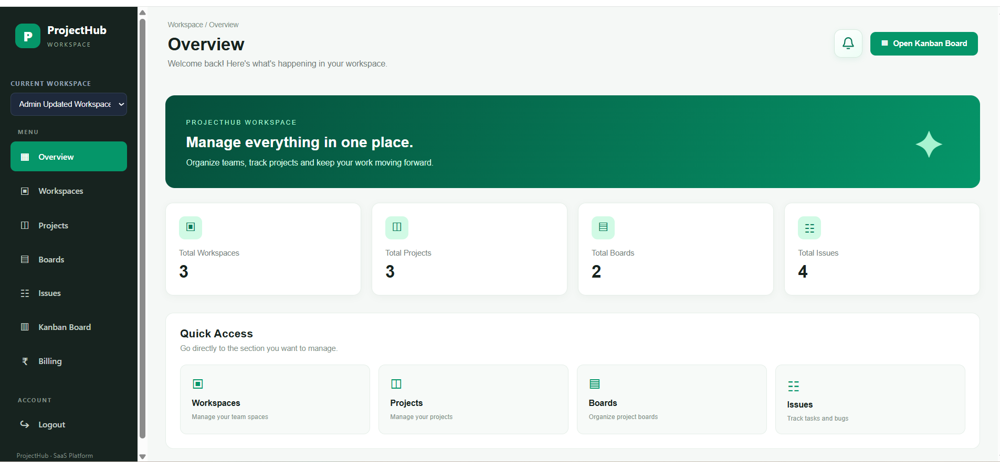

# Multi-Tenant SaaS Project Management Platform

A full-stack SaaS project management application inspired by tools like Jira. It enables teams to manage workspaces, projects, tasks, sprints, and collaboration through a centralized platform with tenant-based data isolation.

## Features

- User authentication and authorization
- Multi-tenant workspaces and membership management
- Project creation and management
- Kanban boards and issue tracking
- Sprint management
- Issue comments and attachments
- Activity logs and notifications
- Workspace-based subscription and billing integration
- Background tasks and due-date reminders
- RESTful API architecture
- Docker-based local development
- Automated backend and frontend checks using GitHub Actions

## Application Preview

### Dashboard



## Tech Stack

### Backend
- Python 3.12+
- Django
- Django REST Framework
- PostgreSQL
- Celery
- Redis
- Stripe API integration

### Frontend
- React
- Vite
- JavaScript
- HTML
- CSS

### Tools and Services
- Neon PostgreSQL
- Upstash Redis
- Docker and Docker Compose
- Git and GitHub
- GitHub Actions

## Project Structure

```text
SaaS-Platform/
├── backend/
│   ├── accounts/
│   ├── billing/
│   ├── config/
│   ├── projects/
│   ├── workspaces/
│   ├── Dockerfile
│   ├── manage.py
│   └── requirements.txt
│
├── frontend/
│   ├── public/
│   ├── src/
│   │   ├── assets/
│   │   ├── components/
│   │   ├── context/
│   │   ├── pages/
│   │   └── services/
│   └── package.json
│
├── docs/
├── .github/
│   └── workflows/
├── docker-compose.yml
└── README.md
```

## Local Installation and Setup

### Prerequisites

- Python 3.12+
- Node.js 22+
- npm
- PostgreSQL database or Neon PostgreSQL
- Git
- Docker Desktop (optional)

### 1. Clone the Repository

```bash
git clone https://github.com/mishrasakshi10/multi-tenant-saas-platform.git
cd multi-tenant-saas-platform
```

### 2. Backend Setup

Open a terminal in the project root:

```powershell
cd backend
python -m venv venv
```

Activate the virtual environment:

```powershell
.\venv\Scripts\Activate.ps1
```

Install dependencies:

```powershell
pip install -r requirements.txt
```

Create a `.env` file inside the `backend` directory.

Configure the following environment variables:

```env
DJANGO_SECRET_KEY=your-secret-key
DATABASE_URL=your-database-url

STRIPE_SECRET_KEY=
STRIPE_PUBLISHABLE_KEY=
STRIPE_WEBHOOK_SECRET=
STRIPE_PRICE_ID=
```

Use your own database connection string and secret credentials. Never commit real credentials or secret keys to GitHub.

Run database migrations:

```powershell
python manage.py migrate
```

Create an administrator account:

```powershell
python manage.py createsuperuser
```

Start the backend development server:

```powershell
python manage.py runserver
```

Backend URL:

http://127.0.0.1:8000/

### 3. Frontend Setup

Open another terminal from the project root:

```powershell
cd frontend
npm install
npm run dev
```

Frontend URL:

http://localhost:5173/

## Docker Setup

Docker and Docker Compose can be used to run the backend and frontend containers.

Run from the project root:

```bash
docker compose up --build -d
```

Check running containers:

```bash
docker compose ps
```

Stop the containers:

```bash
docker compose down
```

## Running Tests

### Backend Tests

From the project root:

```powershell
cd backend
python manage.py test accounts workspaces projects billing --settings=config.settings_test
```

### Frontend Lint

From the frontend directory:

```bash
npm run lint
```

### Frontend Production Build

```bash
npm run build
```

## Background Tasks

Celery and Redis are used for asynchronous background processing, including due-date reminder tasks.

A Celery worker and Celery Beat scheduler are required for background and scheduled tasks to execute.

## Billing Integration

The application includes Stripe subscription and webhook integration.

Live payment processing requires valid Stripe credentials, a configured Stripe Price ID, and a webhook endpoint.

The billing integration can also be tested using mocked API responses without live payment credentials.

## CI/CD

GitHub Actions is configured to automate:

- Backend Django system checks
- Backend automated tests
- Frontend ESLint checks
- Frontend production builds

## Database

The application uses PostgreSQL and supports Neon PostgreSQL through environment-based database configuration.

## Author

**Sakshi Mishra**

GitHub: [mishrasakshi10](https://github.com/mishrasakshi10)

---

*Developed as part of a full-stack software development internship project.*
